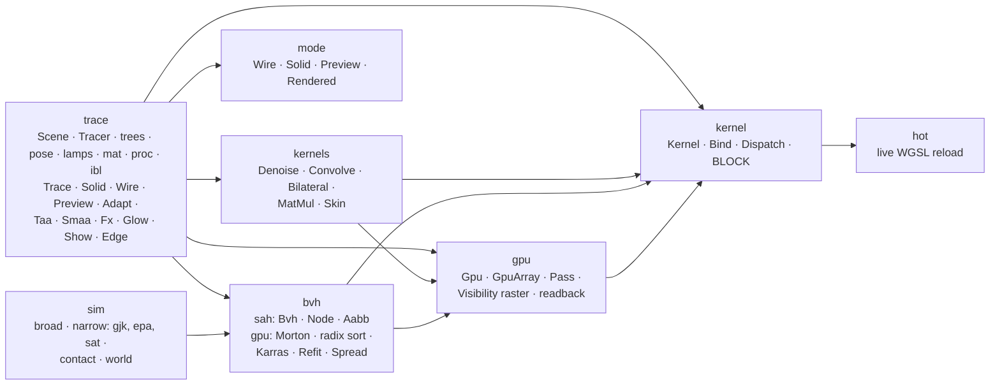
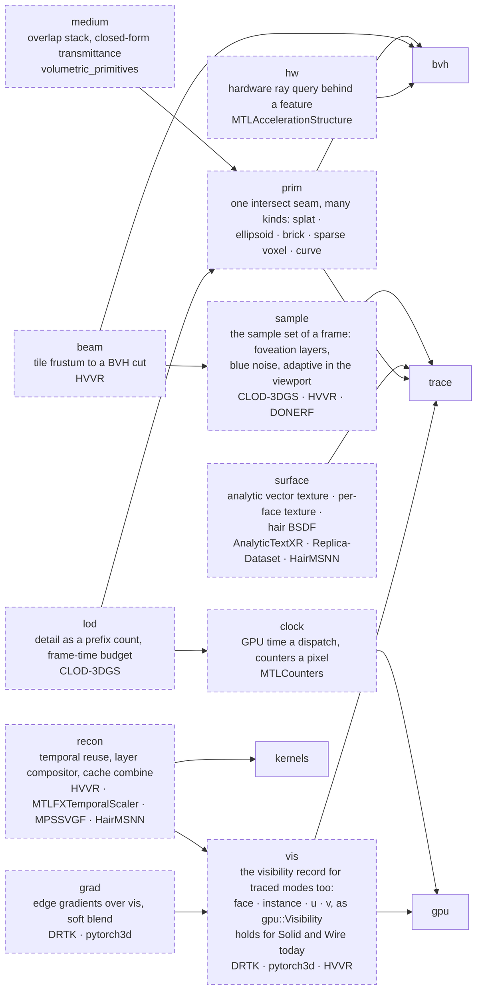
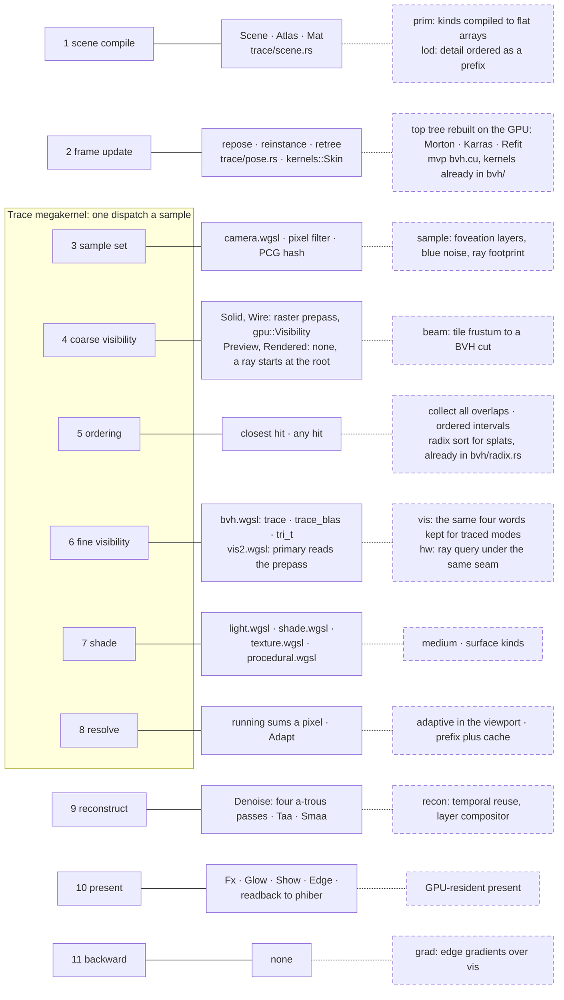

# phiray — architecture

Solid boxes are in the crate today. Dashed boxes are to build, each named
with the reference it is read from (`reference/<repo>`) or the Apple header
it answers. Nothing here is measured; the speed list is
[docs/APPLE.md](docs/APPLE.md).

## The modules today and what they use

## The modules to build and what each stands on

## The frame, as every reference renderer divides it

Read from nine Meta renderers: each keeps stage 6's output as a buffer and
runs 7 to 9 as passes over it. phiray does so for Solid and Wire (the
raster prepass); for Preview and Rendered its megakernel fuses 3 to 8.

## Pages, one subject each

- [frame](docs/frame.md): one sample and its tail today, by mode, and the split to make
- [primitives](docs/primitives.md): the kinds a ray can meet and the one seam they share
- [accel](docs/accel.md): trees, refit, node format, beam cut, ray query
- [sampling](docs/sampling.md): which rays a frame casts, and how many
- [reconstruct](docs/reconstruct.md): from sums to a shown image
- [gradients](docs/gradients.md): the differentiable lane

Folders and order of work: [PLAN.md](PLAN.md) ·
What each part must do: [SPECS.md](SPECS.md) ·
Apple's standards and the speed list: [docs/APPLE.md](docs/APPLE.md) ·
What was ported: [docs/PORTS.md](docs/PORTS.md) ·
The references: [reference/README.md](reference/README.md) ·
What is left to do: [docs/ROADMAP.md](docs/ROADMAP.md)
