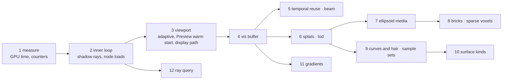
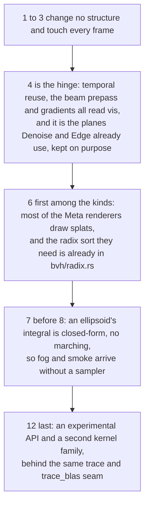
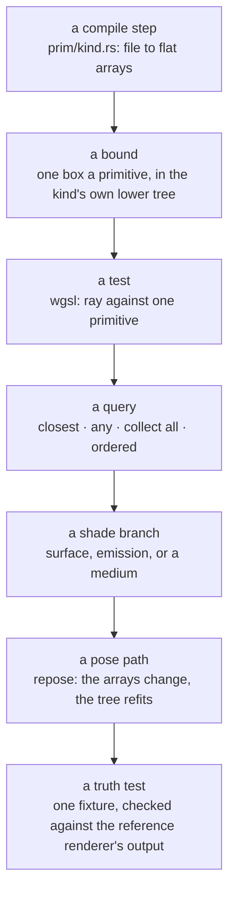

# phiray — plan

The folder tree, today and suggested, and the order to build it in. What
each part must do is in [SPECS.md](SPECS.md); the diagrams are in
[ARCHITECTURE.md](ARCHITECTURE.md). Nothing here is measured: the first
step is to measure.

## The folder tree today

| Path | Holds | Files |
|---|---|---|
| `src/lib.rs` | modules and re-exports | 1 |
| `src/hot.rs` | live WGSL reload | 1 |
| `src/kernel/` | `Kernel`, `Bind`, `Dispatch`, `BLOCK`; Denoise, Convolve, Bilateral, MatMul, Skin | 4 + 2 WGSL |
| `src/mode.rs` | `Mode`: Wire, Solid, Preview, Rendered | 1 |
| `src/gpu/` | `Gpu`, `GpuArray`, `Pass`, `Clock`, `Visibility`, readback, the adapter list | 8 |
| `src/bvh/` | the SAH tree; the GPU tree: Morton, radix sort, Karras, Refit | 11 |
| `src/trace/` | `Scene`, `Tracer` (built, sampled, read: `build.rs`, `sample.rs`, `read.rs`), camera, forest, pose, lamp, light, atlas, materials, procedurals | 26 |
| `src/trace/wgsl/` | every tracing and display kernel | 40 WGSL |
| `src/trace/{forest,ibl,scene,smaa}/` | parts of the above | 5 |
| `src/sim/` | rigid bodies: broad phase, GJK, EPA, SAT, contact | 16 |
| `docs/` | `APPLE.md`, `PORT_LEDGER.md`, `ROADMAP.md`, one page a subject | - |
| `reference/` | 32 Meta repositories, Warp, the index | - |

## The folders to add (suggested)

| Path | Holds | Read from | Order |
|---|---|---|---|
| `src/gpu/clock.rs` | GPU time a dispatch by timestamp query; a hard sync when queries are missing (done) | `MTLCounters.h:43,166` | 1 |
| `src/trace/wgsl/count.wgsl` | counters a pixel: node visits, triangle tests, rays | - | 1 |
| `src/trace/wgsl/bvh.wgsl` | the two inner-loop fixes | `MTLAccelerationStructure.h:144` | 2 |
| `src/trace/adapt.rs` | adaptive sampling in the viewport, dispatch over open pixels | `MTLRasterizationRate.h:244`, `MTLComputeCommandEncoder.h:236` | 3 |
| `src/gpu/cache.rs` | compiled kernels kept on disk | `MTLBinaryArchive.h:61` | 3 |
| `src/vis/mod.rs`, `src/trace/wgsl/walk.wgsl` | the visibility record for Preview and Rendered: the four words a pixel `gpu::Visibility` already holds for Solid and Wire, written by a walk-only kernel | DRTK, pytorch3d, HVVR | 4 |
| `src/recon/temporal.rs`, `wgsl/reproject.wgsl` | motion vectors, reprojection, neighbourhood clamp, variance | HVVR, `MTLFXTemporalScaler.h:337`, `MPSSVGF.h:109` | 5 |
| `src/beam/mod.rs`, `wgsl/beam.wgsl` | tile frusta, the cut, the starting stack a tile | HVVR | 5 |
| `src/prim/mod.rs` | the kind of an instance, the layout of each kind's arrays | - | 6 |
| `src/prim/splat.rs`, `wgsl/splat.wgsl` | Gaussian splats: compile, bound, closed-form response | vkraygs, volumetric_primitives | 6 |
| `src/lod/mod.rs` | prefix order, the frame-time budget | CLOD-3DGS | 6 |
| `src/prim/ellipsoid.rs`, `src/medium/`, `wgsl/medium.wgsl` | ellipsoid media, the overlap stack, transmittance | volumetric_primitives | 7 |
| `src/prim/brick.rs`, `src/prim/voxel.rs` | bricks in oriented boxes, sparse voxels | mvp, NSVF, lightplane | 8 |
| `src/prim/curve.rs`, `wgsl/curve.wgsl`, `wgsl/hair.wgsl` | cubic strands, the hair BSDF | HairMSNN, `MTLAccelerationStructure.h:548` | 9 |
| `src/sample/` | foveation layers, blue noise, ray footprints | CLOD-3DGS, HVVR, DONERF | 9 |
| `src/surface/` | per-face textures, analytic vector textures | Replica-Dataset, AnalyticTextXR | 10 |
| `src/grad/` | edge gradients over `vis` | DRTK, pytorch3d | 11 |
| `src/hw/` | hardware ray query behind a feature | `MTLAccelerationStructure.h:201` | 12 |
| `src/gpu/mod.rs` | for the web: the device opened through the async door that has no caller today; a constructor that adopts a device and queue another crate already holds | phikit `docs/web.md`, blockers 1 and 3 | with 3 |
| `src/gpu/present.rs` | the traced image handed on as a texture, with no readback: what the web needs and what the desktop's present path wants | `CAMetalLayer.h:54`; phikit `docs/web.md` | with 3 |

Names are singular: files, folders and types. A name for many things is a
collective noun (`Forest`, `Histogram`), a `...List` (`LampList`,
`GpuAdapterList`, `BIND_LIST`), or failing both a `P` prefix; counts end in
`_COUNT`, caps start `MAX_`, lengths in words end in `_LEN`. `tests/`,
`examples/` and `benches/` keep Cargo's names.

Suggested, not decided: `src/trace/wgsl/` holds 38 files in one folder. As
kernels are added, group them by stage (`walk/`, `shade/`, `display/`,
`solid/`) so a stage's kernels sit together.

## Order of work

## Why this order

## What each new kind needs, end to end

